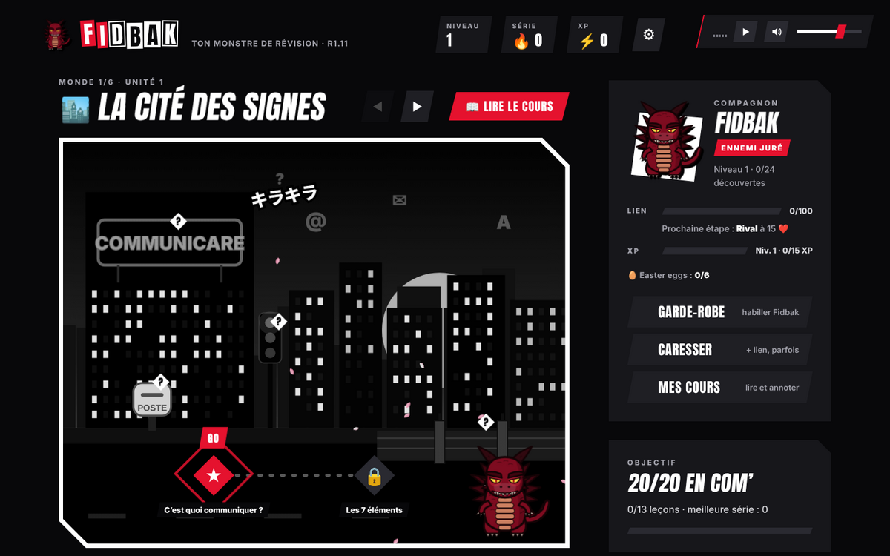
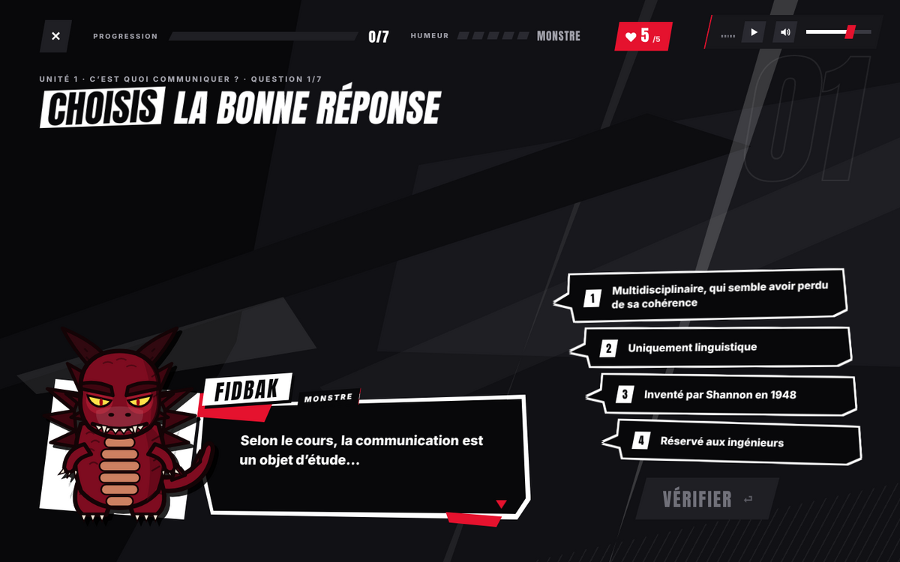

# Fidbak

**Un petit monstre qui t’aide à réviser R1.11 « Bases de la communication ».**

Pour les 1re année de **BUT Informatique à Aix-en-Provence** · cours 1 à 4 de **Madame Salou**

---

## C’est quoi ?

Une appli de révision façon Duolingo, en noir, blanc et rouge. **Fidbak**, un kaiju moqueur, se fout de toi quand tu te trompes, devient un petit chibi kawaii quand tu enchaînes les bonnes réponses… et te met K.O. quand tu n’as plus de cœurs.

## Ce qu’il y a dedans

| Monde | Cours |
|---|---|
| 🏙️ Cité des Signes | Les bases de la com’ : origines du mot, 5 sens, 7 éléments |
| 🗼 Vieux Paris des Médias | Histoire des médias : toutes les dates, de l’imprimerie à Internet |
| 📡 Ville des Ondes | Communication de masse : Lazarsfeld, Lewin |
| 🔌 Labo Télégraphe | Communication télégraphique : Shannon & Weaver, Wiener, Turing |
| 🌉 Palo Alto | Communication orchestrale : Bateson, Birdwhistell, Hall |
| 👹 L’Arène du Boss | Contrôle blanc qui mélange tout |

- 📝 6 types d’exercices : QCM, vrai/faux, phrase à trous, réponse à écrire, remettre dans l’ordre, paires
- 📖 Des fiches de cours détaillées que tu peux **annoter** (stylo, surligneur, gomme)
- 🎵 Musique et sons générés par le navigateur, 🥚 6 easter eggs cachés
- ⌨️ Jouable entièrement au clavier : flèches / ZQSD, Entrée, Échap

## Jouer

👉 **[itsnotjalan.github.io/fidbak-r111](https://itsnotjalan.github.io/fidbak-r111/)**

Sur téléphone, tourne-le à l’horizontale.

Ou télécharge `index.html` et ouvre-le : ça marche sans internet. Ta progression reste dans ton navigateur.

---

Projet perso d’entraînement, non officiel. En cas de doute, c’est le cours de Madame Salou qui fait foi.

